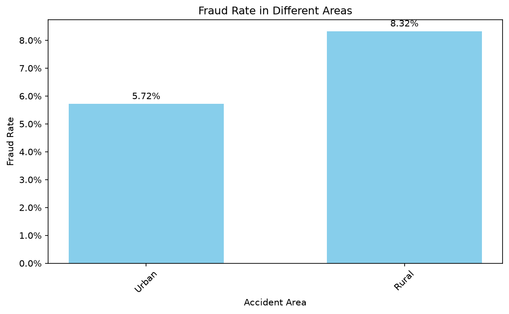
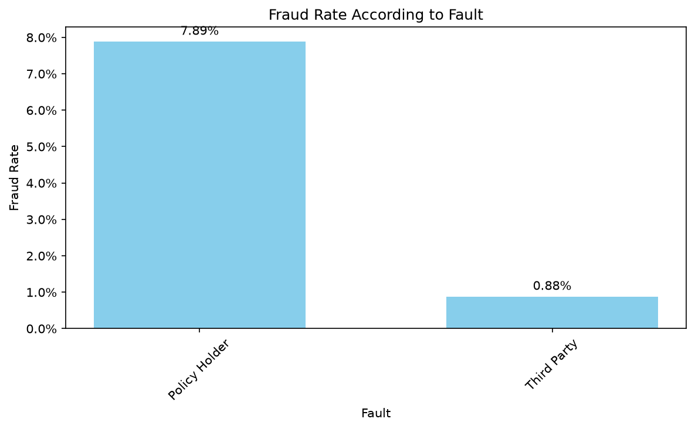
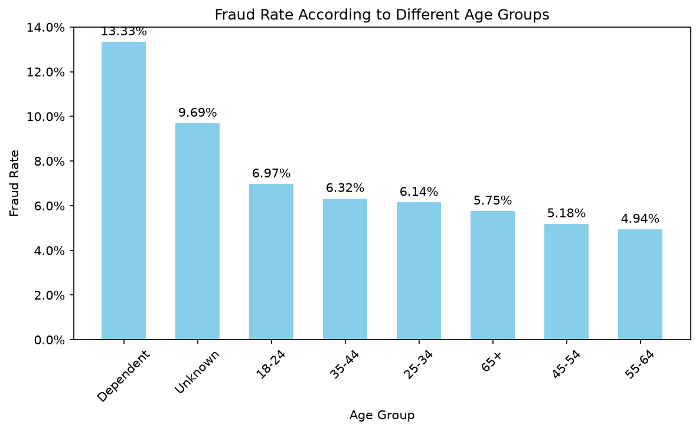
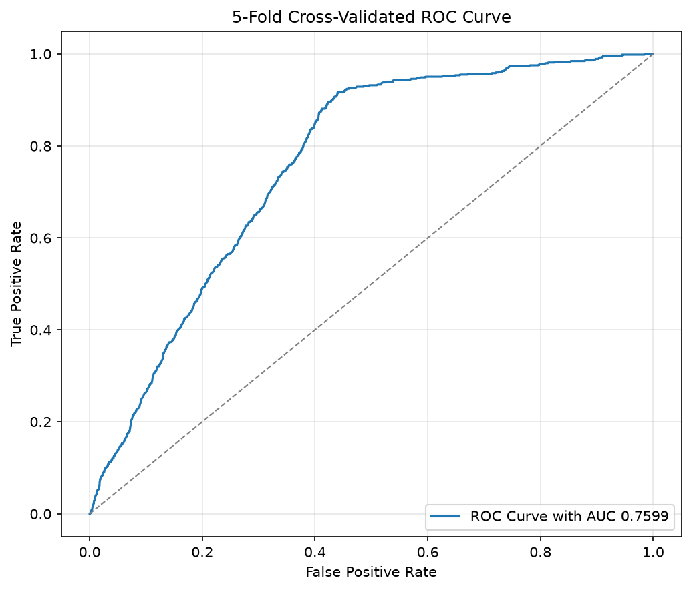

# Motor Insurance Fraud Detection

> Exploratory analysis, statistical testing and predictive modelling on 15,420 motor insurance claims

## Key findings at a glance

- **Fault status dominates.** Third-party-fault claims have roughly **1/12.7 the odds of fraud** compared with policyholder-at-fault claims (adjusted OR = 0.079, 95% CI 0.053–0.119).
- **Vehicle type and price interact.** The "sport vehicle + low price" segment shows only **16% of the reference odds**, and the interaction is significant (LR = 39.21, df = 1, p < 0.001).
- **Most univariate effects do not survive adjustment.** AccidentArea moves from p = 3.2e-05 to **0.398**; AgeGroup from 0.013 to **0.280**.
- **Model performance.** 5-fold cross-validated **AUC = 0.7599 ± 0.0113**; at the F1-optimal threshold, recall 54.2% / precision 12.5%.

→ Detailed results in [Key Findings](#key-findings).

## Overview

Insurance fraud causes substantial losses every year, yet manually reviewing every claim is prohibitively expensive. This project answers three questions:

1. **Which factors are genuinely associated with fraudulent claims?** (univariate view)
2. **Do those associations hold after controlling for other factors?** (multivariate view)
3. **How well does the model predict, and what business value does it create?** (predictive view)

## Dataset

| Item | Detail |
|---|---|
| Name | Vehicle Insurance Fraud Detection |
| Source | See [Data Source & Acknowledgements](#data-source--acknowledgements) |
| Size | 15,420 rows × 33 columns |
| Target | `FraudFound_P` (1 = fraudulent, 0 = legitimate) |
| Positive rate | **5.99%** (923 fraudulent claims, 95% CI: 5.62% – 6.37%) |
| Raw file | `data/carclaims.csv` (included in this repository) |

## Methodology

```
Raw data
   │
   ├─ ① SQL data preparation (MySQL)
   │    Schema creation, NULL audit, dimensional fraud-rate queries
   │    (CTEs / window functions / correlated subqueries)
   │
   ├─ ② Cleaning and missing-value handling (Python / pandas)
   │    Invalid zeros → missing, age binning, category merging
   │
   ├─ ③ Univariate screening
   │    Chi-square test + Cramér's V (significance + association strength)
   │    IV / WOE (standard risk-modelling metrics, with direction)
   │    Wilson 95% confidence intervals for each category's fraud rate
   │
   ├─ ④ Multivariate modelling
   │    Logistic regression (statsmodels)
   │    Variable selection via per-variable likelihood-ratio tests
   │    Interaction testing (vehicle category × price band)
   │
   └─ ⑤ Model evaluation
        5-fold stratified cross-validation (out-of-fold predictions)
        ROC / AUC, threshold sweep, confusion matrix
```

## Key Findings

### 1. Fault status is the strongest single predictor

| Metric | Value |
|---|---|
| Policyholder at fault vs third party at fault | 7.89% vs 0.88% |
| Adjusted odds ratio | **0.079** (95% CI: 0.053 – 0.119) |
| Per-variable likelihood-ratio test | 323.32 (df=1, p < 0.001) |

Claims where the third party was at fault have roughly **1/12.7** the odds of fraud compared with policyholder-at-fault claims.

### 2. Vehicle category and price interact significantly

- Sport vehicles: 1.57% fraud rate; Sedans: 8.22%
- Category × price-band interaction: **LR = 39.21, df = 1, p < 0.001**
- The "sport + low price" segment has only **16%** the odds of the reference group (OR = 0.16)

### 3. Univariate significance does not survive adjustment

| Variable | Univariate chi-square p | Adjusted p | Conclusion |
|---|---|---|---|
| AccidentArea | 3.2e-05 | **0.398** | Effect explained by other variables |
| AgeGroup | 0.013 | **0.280** | Effect explained by other variables |
| PastNumberOfClaims | 1.4e-11 | **0.171** | Not significant once `NumberOfSuppliments` is included |

This is the project's central methodological finding: **univariate screening alone overstates a variable's value.**

### 4. Predictive performance

| Metric | Value |
|---|---|
| 5-fold cross-validated AUC | **0.7599 ± 0.0113** |
| Test-set AUC | 0.7561 |
| Threshold (F1-optimal) | 0.11 |
| Test-set recall | 54.2% |
| Test-set precision | 12.5% |

## Business Implications

1. **Third-party-fault claims can be deprioritised for review** — their fraud rate is roughly 1/8 of policyholder-at-fault claims, making fault status the strongest triage signal.
2. **The "sport vehicle + low price" segment is low-risk** — 0.64% fraud rate; a candidate for a fast-track process.
3. **Accident area and age should not drive pricing on their own** — their apparent effects disappear once vehicle type and fault status are controlled for.
4. **The model can cut the review queue by ~74% while still capturing 54% of fraudulent claims** — about 2.1× the precision of random sampling.

> ⚠️ F1 is nearly flat across thresholds 0.04–0.11 (0.2104–0.2109), while recall drops from 88% to 54%. In practice the threshold should be set from investigation capacity and the relative cost of missed fraud, not from F1 alone.

## Visualizations

### Accident area



Rural claims (8.32%) exceed urban claims (5.72%), but the difference is no longer significant after adjustment (p = 0.398).

### Fault status — the strongest single factor



Policyholder-at-fault claims show a 7.89% fraud rate versus 0.88% for third-party claims. The multivariate model confirms this (OR = 0.079).

### Age group



Apparent differences by age group disappear after controlling for other factors (p = 0.280).

### Model discrimination



5-fold cross-validated ROC curve, AUC = 0.7599.

## Project Structure

```
car-insurance-fraud/
├── README.md
├── LICENSE
├── requirements.txt
├── .gitignore
├── data/
│   ├── README.md                  # data source, field dictionary, cleaning rules
│   └── carclaims.csv              # raw data
├── sql/
│   ├── README.md
│   ├── 01_schema.sql              # schema, field audit, basic fraud rates
│   └── 02_advanced_queries.sql    # CTEs / window functions
├── python/
│   ├── insurance_claims_load.py       # data loading and cleaning
│   ├── insurance_claims_analysis.py   # descriptive analysis and charts
│   └── insurance_claims_adv.py        # statistical testing, modelling, evaluation
├── results/
│   ├── combined_ci_iv_analysis.csv    # fraud rate + CI + WOE + IV per category (75 rows)
│   └── combined_chisq_iv_analysis.csv # chi-square + Cramér's V + IV per variable (13 rows)
└── images/
    └── *.png                      # charts
```

## Output Files

Running `python/insurance_claims_adv.py` writes two tables to `results/`:

| File | Rows | Contents |
|---|---|---|
| `combined_ci_iv_analysis.csv` | 75 | Per variable per category: fraud count, total claims, fraud rate, share of total fraud, Wilson 95% CI, WOE, IV contribution |
| `combined_chisq_iv_analysis.csv` | 13 | Per variable: N, number of levels, chi-square, p-value, degrees of freedom, critical value, Cramér's V, significance flag, IV |

These two tables drive variable selection and serve as the raw appendix data for the analysis.

## How to Run

```bash
# 1. Install dependencies
pip install -r requirements.txt

# 2. Prepare the data
#    Place carclaims.csv in data/ (see data/README.md)

# 3. Run the analysis (both scripts depend on insurance_claims_load.py in the same folder)
cd python
python insurance_claims_analysis.py   # descriptive analysis and charts
python insurance_claims_adv.py        # statistical testing, modelling and evaluation
```

## SQL Techniques

The queries under `sql/` cover:

- **CTEs (`WITH`)** — stepwise aggregation instead of deeply nested subqueries
- **Correlated subqueries** — per-dimension fraud counts
- **Window functions** — `DENSE_RANK() OVER()` for risk ranking, `SUM() OVER()` for share-of-total calculations
- **NULL safety** — `NULLIF()` to prevent division by zero, `COALESCE()` / `IFNULL()` for missing values
- **Dynamic SQL** — `information_schema` + `PREPARE` to generate a column-level NULL audit in one statement

## Limitations

1. **No out-of-time validation** — the dataset has no reliable time split, so training and evaluation use the same period.
2. **Variable selection and category merging were performed on the full sample** — AUC may be slightly optimistic.
3. **Categorical features only** — claim amount, deductible and other numeric fields are not yet included.
4. **Threshold derived from out-of-fold predictions** — a single parameter carries mild optimism (AUC is unaffected).
5. **AUC 0.76 is a moderate result** — fraud signals are inherently sparse; comparable industry models typically land between 0.70 and 0.80.
6. **The age × sex interaction was excluded due to complete separation** — the `AgeGroup=Unknown` / `Sex=Female` cell contains a single observation, causing coefficient divergence.

## Data Source & Acknowledgements

### Dataset

This project uses the public *Vehicle Insurance Fraud Detection* dataset (15,420 motor insurance claim records, 33 fields).

- Data file obtained from:
  [insurance-claims-analysis / data / carclaims.csv](https://github.com/Saharaxi/insurance-claims-analysis/blob/main/data/carclaims.csv)
- Original dataset: *Vehicle Insurance Fraud Detection* (add the original publishing page here if available)
- Data licence: not declared by the source repository. The data file is redistributed with this repository for learning and research purposes only

### Analysis framework

The analytical framework was informed by
[@Saharaxi/insurance-claims-analysis](https://github.com/Saharaxi/insurance-claims-analysis),
which uses the same dataset for SQL-based descriptive statistics and basic visualisation.

To be explicit:

- **All code in this project is independently written**; no source code was copied from that repository;
- The original repository declares no open-source licence, so this project reuses only the public dataset and the problem framing;
- This project extends the original with statistical testing and predictive modelling (see below).

### Extension

The original analysis stops at descriptive statistics and notes in its conclusion that
"further statistical analysis would be required to control for other factors".
This project does exactly that:

| Original project (descriptive) | This project (testing + modelling) |
| --- | --- |
| Fraud-rate differences by area and age group | Chi-square + Cramér's V + IV/WOE |
| Univariate comparisons | Per-variable likelihood-ratio tests (controlling for other factors) |
| —— | Logistic regression + 5-fold CV + ROC/AUC |

Core result: most differences that look significant in isolation do not survive adjustment
(for example, AccidentArea moves from p = 3.2e-05 to p = 0.398); only fault status and
vehicle characteristics retain independent effects.

### Tools

- Python 3.14 / pandas / numpy / scipy / statsmodels / scikit-learn / matplotlib
- MySQL 8.0

## License

Code in this project is released under the [MIT License](LICENSE).

The dataset remains the property of its original provider. This project is intended for
learning and research purposes only and makes no claim of ownership over the data.
